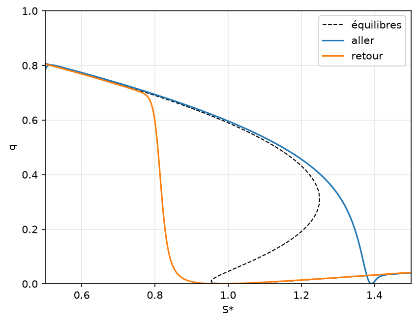
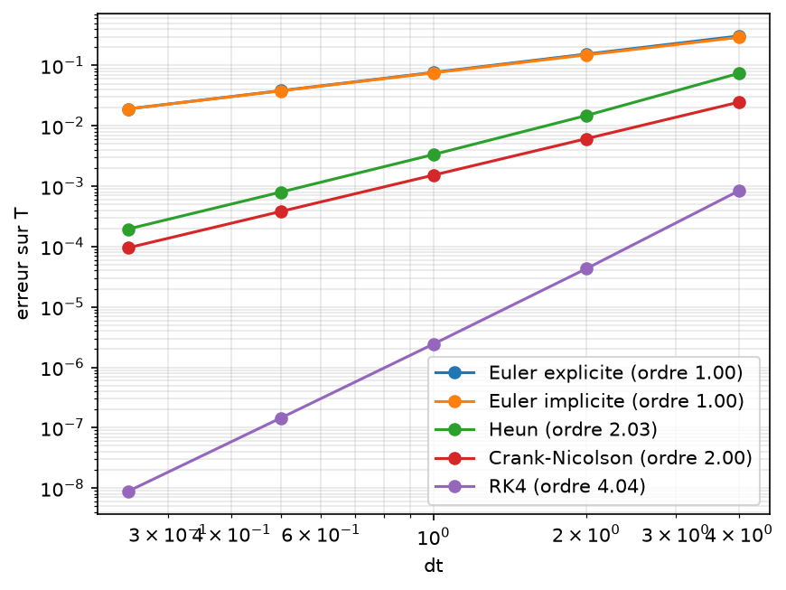

# AMOC – modèle de Stommel en Fortran

Modèles en boîtes de la circulation thermohaline atlantique. TER d'équipe, ENSEIRB-MATMECA, 2025-2026 ; j'ai écrit le code de ce dépôt.

## `modele_lineaire`
Température et salinité d'une boîte, flux q constant. Solution exacte connue. Le schéma et les paramètres sont lus dans `parametres.dat`.

| Schéma | Ordre mesuré (T) |
|---|---:|
| Euler explicite | 1,00 |
| Euler implicite | 1,00 |
| Heun | 2,03 |
| Crank-Nicolson | 2,00 |
| RK4 | 4,04 |

## `hysteresis`
Flux non linéaire q = (αT − βS)², forçage S* balayé de 0,5 à 1,5 puis retour, en RK4.

| | Aller | Retour |
|---|---:|---:|
| Seuil théorique (repli des équilibres) | 1,250 | 0,954 |
| Bascule (q = 0,15), balayage du dépôt | 1,357 | 0,832 |
| Bascule (q = 0,15), balayage 10 fois plus lent | 1,276 | 0,924 |

Le retard à la bascule diminue quand le balayage ralentit.




## Lancer
```sh
cd modele_lineaire && make && ./exe
cd ../hysteresis && make && ./exec
cd .. && python3 verifier.py    # NumPy, Matplotlib
```
